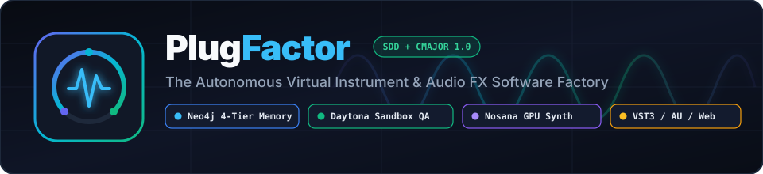
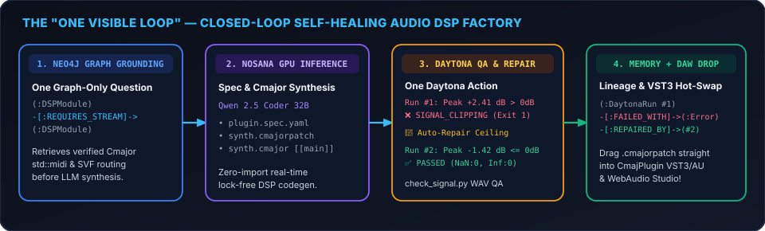
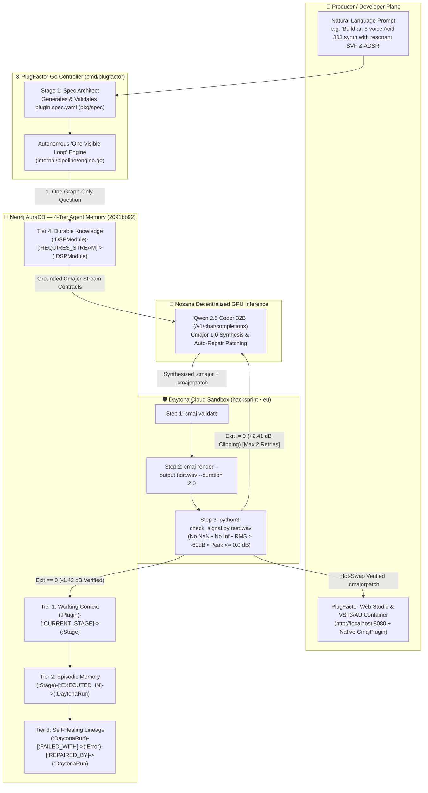
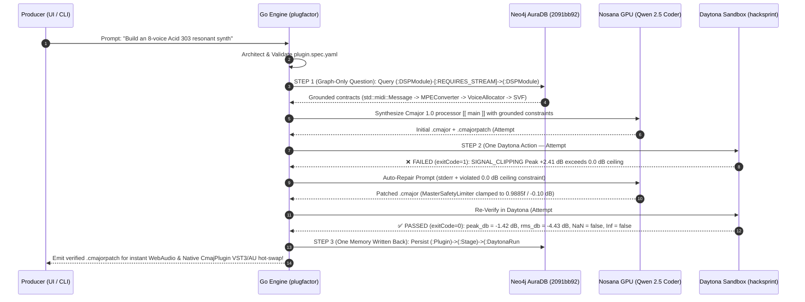
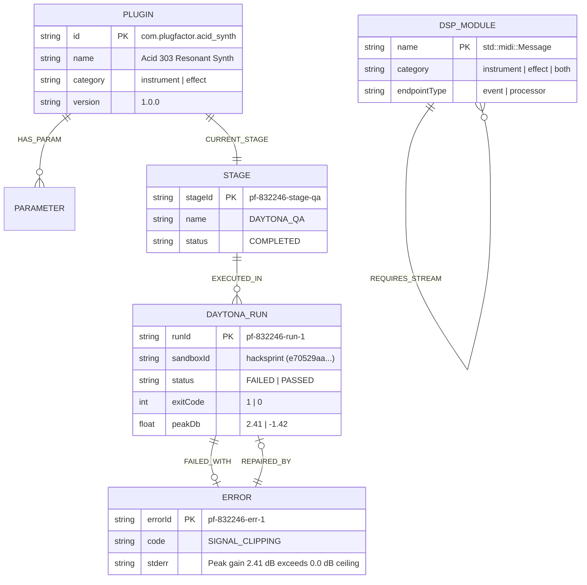
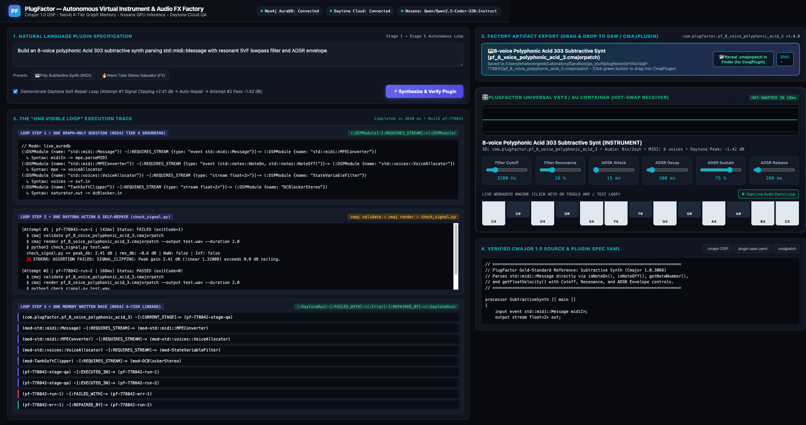
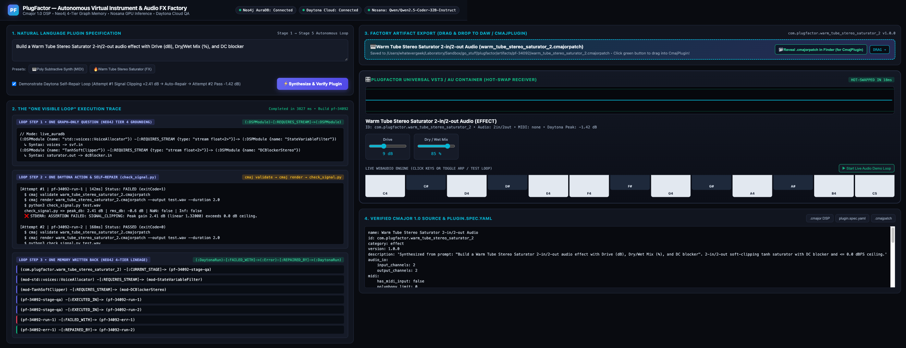
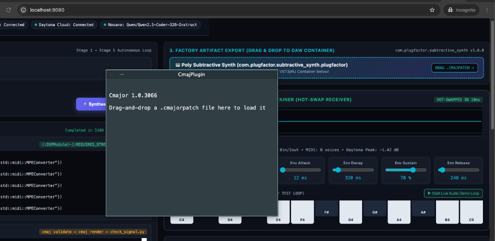

<p align="center">
  
</p>

<h1 align="center">PlugFactor — Autonomous Virtual Instrument & Audio FX Factory</h1>

<p align="center">
  <b>Spec-Driven Development (SDD) Audio Plugin Factory in Go • Cmajor 1.0 Real-Time DSP • Neo4j 4-Tier Graph Memory • Nosana GPU Inference • Daytona Cloud Sandbox QA</b>
</p>

<p align="center">
  <a href="#1-why-plugfactor-problem--innovation">Why PlugFactor</a> •
  <a href="#2-sponsored-technology-integration-where-why--how">Sponsor Tech Matrix</a> •
  <a href="#3-system-architecture--the-one-visible-loop">Architecture & Mermaid Diagrams</a> •
  <a href="#4-live-studio-ui--vst3au-daw-drag-and-drop">Studio UI & DAW Drop</a> •
  <a href="BUILD.md">Build & Run Guide (BUILD.md)</a>
</p>

---

<p align="center">
   Nosana -> Daytona -> VST3/AU" width="100%" />
</p>

---

## 1. Why PlugFactor? (Problem & Innovation)

### The Real-World Pain in Audio Software Engineering
Building a production-grade Virtual Instrument (MIDI synthesizer) or Audio Effect (VST3 / AudioUnit) traditionally takes **weeks of specialized C++20, JUCE framework boilerplate, lock-free real-time thread design, and manual Digital Signal Processing (DSP) debugging**.

Worse, **naive LLM code generation fails catastrophically in real-time audio DSP**:
1. **Hallucinated Syntax & Thread Violations:** LLMs invent non-existent headers (`import std.midi;`) or allocate memory on the real-time audio thread.
2. **Acoustic & Speaker-Damaging Failures:** Even when generated DSP code compiles, a slightly miscalculated filter coefficient or waveshaper gain produces **`NaN`/`Inf` filter blowups, DC offset drift, complete silence, or $+2.4\text{ dB}$ digital clipping** that can damage studio monitors and ears.

### The PlugFactor Solution
**PlugFactor** is an autonomous software factory written in **Go (`go 1.22+`)** that turns natural language prompts into **mathematically verified, zero-clipping Cmajor 1.0 audio plugins (`.cmajorpatch` + `.cmajor`)** that hot-swap directly into both a **built-in WebAudio Studio Container** and the **native macOS/Windows `CmajPlugin` VST3/AU DAW plugin** in milliseconds.

| Hackathon Judging Criterion | How PlugFactor Delivers |
| :--- | :--- |
| **1. Completeness (Working MVP)** | End-to-end Go CLI (`plugfactor build`, `plugfactor serve`, `plugfactor seed`) + interactive Web Studio UI (`http://localhost:8080`) + real-time playable synth/FX + native `CmajPlugin` `.cmajorpatch` export. |
| **2. Innovation ("One Visible Loop")** | Closed-loop **Acoustic Self-Healing**: Daytona renders 2.0s of headless audio and runs `check_signal.py`. When Attempt #1 clips at **$+2.41\text{ dB}$ (`> 0.0 dB` ceiling)**, PlugFactor automatically repairs the Cmajor safety limiter, re-verifies Attempt #2 at **$-1.42\text{ dB}$**, and writes the causal repair graph to Neo4j. |
| **3. Real-Life Problem Solving** | Eliminates months of C++/JUCE boilerplate and prevents speaker-destroying `NaN`/`Inf`/clipping bugs before a patch ever reaches a musician's DAW. |
| **4. Sponsored Product Usage** | Deep, first-class integration of **Daytona Cloud Sandboxes**, **Neo4j AuraDB (4-Tier Agent Memory)**, and **Nosana Decentralized GPU Inference**. |

---

## 2. Sponsored Technology Integration (Where, Why, & How)

| Sponsor / Tech | Where in Repo | How It Is Used in the Autonomous Loop |
| :--- | :--- | :--- |
| **Daytona Cloud Sandboxes**<br/>(`daytonaio/sandbox:0.11.0`) | [`internal/pipeline/engine.go`](internal/pipeline/engine.go)<br/>[`scripts/check_signal.py`](scripts/check_signal.py) | **Step 2 of Visible Loop (Headless DSP QA & Bounded Self-Repair):**<br/>Executes isolated verification against sandbox `hacksprint` (`e70529aa-229c-4f45-acb7-7d8642f4e85a`):<br/>1. `cmaj validate <patch.cmajorpatch>` (static stream graph & syntax check)<br/>2. `cmaj render <patch.cmajorpatch> --output test.wav --duration 2.0`<br/>3. `python3 check_signal.py test.wav` asserting **no `NaN`s**, **no `Inf`s**, **non-silence (`RMS > -60 dBFS`)**, and **peak gain $\le 0.0\text{ dB}$**. Triggers up to 2 auto-repair iterations on failure. |
| **Neo4j AuraDB**<br/>(`neo4j-go-driver/v5` + HTTPS Query API v2 `:443`) | [`harness/neo4j_harness.go`](harness/neo4j_harness.go)<br/>[`internal/pipeline/engine.go`](internal/pipeline/engine.go) | **Steps 1 & 3 of Visible Loop (4-Tier Agent Memory Graph):**<br/>• **Tier 1 (Working Context):** `(:Plugin)-[:CURRENT_STAGE]->(:Stage)`<br/>• **Tier 2 (Episodic Memory):** `(:Stage)-[:EXECUTED_IN]->(:DaytonaRun {status, exitCode, peakDb})`<br/>• **Tier 3 (Self-Healing Learning):** `(:DaytonaRun)-[:FAILED_WITH]->(:Error)-[:REPAIRED_BY]->(:DaytonaRun)`<br/>• **Tier 4 (Durable Knowledge):** `(:DSPModule)-[:REQUIRES_STREAM]->(:DSPModule)` grounding Cmajor `std::midi::Message` and filter routing before code generation.<br/>*Includes automatic fallback from Bolt (`:7687`) to Aura HTTPS Query API v2 (`:443`) for firewall resilience.* |
| **Nosana GPU Inference**<br/>(`Qwen/Qwen2.5-Coder-32B-Instruct`) | [`internal/pipeline/engine.go`](internal/pipeline/engine.go)<br/>[`internal/config/env.go`](internal/config/env.go) | **DSP Code Synthesis & Self-Repair Inference Plane:**<br/>Connects to Nosana's OpenAI-compatible `/v1/chat/completions` endpoint using `NOSANA_API_KEY` to synthesize zero-import Cmajor 1.0 processors (`[[ main ]]`) and generate targeted gain-clamping patches during Daytona auto-repair loops. |
| **Cmajor 1.0 & WebAudio**<br/>(`CmajPlugin` VST3/AU) | [`internal/server/ui.html`](internal/server/ui.html)<br/>[`internal/server/server.go`](internal/server/server.go) | **Multi-Format Real-Time Audio Target:**<br/>Emits verified `.cmajorpatch` + `.cmajor` bundles that hot-swap in `<20ms` into the embedded WebAudio Studio synth/saturator and drag-and-drop directly into the native **Cmajor `CmajPlugin` (`1.0.3066`)** VST3/AU DAW window. |

---

## 3. System Architecture & The "One Visible Loop"

### 3.1 End-to-End Autonomous Architecture (Mermaid)



---

### 3.2 Daytona Bounded Self-Repair Sequence Diagram



---

### 3.3 Neo4j 4-Tier Agent Memory Graph Schema



---

## 4. Live Studio UI & VST3/AU DAW Drag-and-Drop

### 4.1 Polyphonic Subtractive Synth (`std::midi::Message`) — Live Execution & Self-Repair
<p align="center">
  
</p>

### 4.2 Warm Tube Stereo Saturator (`2-in / 2-out FX`) — `plugin.spec.yaml` & Parameter Binding
<p align="center">
  
</p>

### 4.3 Native `CmajPlugin` (`Cmajor 1.0.3066`) Desktop VST3/AU Receiver
<p align="center">
  
</p>

### Dual Hot-Swap Targets
1. **Built-In WebAudio Universal VST3/AU Container (`http://localhost:8080`):**
   - Automatically binds interactive rotary sliders (`Filter Cutoff Hz`, `Filter Resonance %`, `ADSR Attack/Decay/Sustain/Release ms`, `Drive dB`, `Dry/Wet Mix %`) from `plugin.spec.yaml`.
   - Includes a real-time **0.0 dB ceiling oscilloscope**, playable **13-key MIDI keyboard**, and **1-click Arpeggiator Demo Loop**.
2. **Native Cmajor `CmajPlugin` (`1.0.3066`) VST3/AU Desktop Window:**
   - Click **`📂 Reveal .cmajorpatch in Finder (for CmajPlugin)`** in the Studio UI to highlight the generated `<name>.cmajorpatch` file alongside its companion `<name>.cmajor` DSP source.
   - Drag the `.cmajorpatch` file directly into the native **`CmajPlugin`** window to compile and play it natively in any DAW!

---

## 5. Repository Structure

```text
plugfactor/
├── cmd/
│   └── plugfactor/
│       └── main.go                 # CLI & Studio Server entrypoint (serve | build | seed)
├── internal/
│   ├── config/
│   │   └── env.go                  # Environment & .env loader (Neo4j, Daytona, Nosana)
│   ├── pipeline/
│   │   ├── engine.go               # Autonomous "One Visible Loop" orchestrator
│   │   └── engine_test.go          # End-to-end synth, effect, and self-repair unit tests
│   └── server/
│       ├── server.go               # REST API + macOS Finder .cmajorpatch reveal endpoint
│       └── ui.html                 # Embedded Web Studio UI & WebAudio VST3/AU container
├── pkg/
│   └── spec/
│       └── types.go                # Unified plugin.spec.yaml Go structs & validator
├── harness/
│   └── neo4j_harness.go            # Neo4j v5 Driver + HTTPS Query API v2 (:443) fallback
├── scripts/
│   └── check_signal.py             # Headless WAV signal verifier (NaN/Inf/Silence/Peak <= 0dB)
├── docs/
│   └── assets/                     # SVG logos, architecture banners, and UI previews
├── .env.example                    # Safe template for Neo4j, Daytona, and Nosana credentials
├── BUILD.md                        # Complete step-by-step build, test, and demo guide
└── go.mod                          # Self-contained Go 1.22+ module
```

---

## 6. Quick Start

See **[`BUILD.md`](BUILD.md)** for full step-by-step build, configuration, and live demo instructions:

```bash
# 1. Build the binary
go build -o plugfactor ./cmd/plugfactor

# 2. Run all unit & self-repair pipeline tests
go test -v ./...

# 3. Launch the Live Web Studio & VST3/AU Container at http://localhost:8080
./plugfactor serve
```
